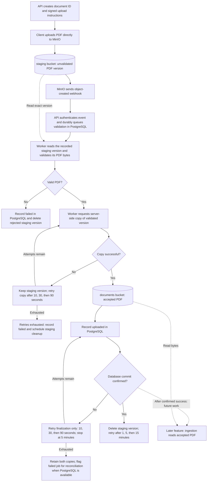

# Direct PDF upload: backend and MinIO

**Status:** Direct-upload/webhook direction, PostgreSQL, and two buckets approved in chat.
This revised written spec awaits review. It replaces the previous synchronous
multipart upload design. Only backend and infrastructure work is current;
there is no frontend integration plan in this slice.

## Outcome and boundary

Continue feature 2 with direct-to-MinIO uploads, durable document status, and
background PDF validation. Express handles short metadata/status/webhook
requests; PDF bytes travel from the client to MinIO. PostgreSQL stores document
records and durable jobs, and a separate Node worker validates stored files.

This slice includes Docker setup, API contracts, validation, and backend tests.
Frontend changes, session attachment and its one-document rule, extraction,
tokenization, retrieval, and question answering remain deferred. Internal upload
records support recovery; they do not introduce user accounts or a document
library. An accepted PDF is not yet ready for questions.

## API contract

| Endpoint | Behavior |
|---|---|
| `POST /documents` | Accept JSON `{ filename, size, contentType }`. Validate metadata, reserve a UUID document ID, and return 201 with `documentId`, `status: "awaiting_upload"`, `statusUrl`, and `upload: { url, fields, expiresAt }`. These are temporary signed POST instructions, not storage credentials. |
| `GET /documents/:id/status` | Read PostgreSQL and return `documentId`, `filename`, `status`, `updatedAt`, and a sanitized `error` when failed. Return 404 for an unknown ID. |
| `POST /webhooks/minio` | Authenticate the MinIO notification, match its bucket/key/version to a reserved document, and durably schedule validation. Acknowledge with 204 only after persistence succeeds. Do not parse PDF bytes or run ingestion in this request. |
| `GET /health` | Preserve process-health behavior; it does not assert dependency readiness. |

There is no multipart file endpoint or frontend `/complete` callback. MinIO
object-created notifications establish that a complete object exists. An event
means upload completion, not proof that the file contains a valid PDF.

Require a nonempty `.pdf` filename (case-insensitive), declared content type
`application/pdf`, and integer size from 1 through **10,485,760 bytes (10 MiB)**.
Return 400 for malformed metadata/IDs, 415 for an unsupported declared file type,
413 for a declared oversized file, 401 for unauthenticated webhooks, 503 for
unavailable dependencies, and a generic 500 for unexpected failures. Errors use
`{ "error": { "code": "...", "message": "..." } }`. Bound JSON bodies and
never expose credentials, internal object keys, or raw dependency errors in
status/error responses. The upload form necessarily includes its permitted key.

## MinIO upload and notification configuration

Create private `staging` and `documents` buckets. Use `<id>.pdf` as the object key
in each bucket, where `<id>` is the document UUID, not the supplied filename.
Issue a signed POST policy for that exact bucket/key, declared content type,
and exact declared byte size,
within the 10 MiB maximum. Upload permission expires after 30 minutes. Store
the original filename in PostgreSQL; use header-safe encoded metadata when
writing the accepted object. Configure CORS for explicitly configured browser
origins so later frontend work can consume the contract; do not expose secrets.

Enable staging object versioning. A signed upload may be replayed until expiry,
so record the exact version from the first accepted creation event and validate
that immutable version. Browser upload permission never grants writes to the
accepted-document bucket. Later staging overwrites cannot change accepted PDF
bytes or restart an already claimed document.

Configure object-created notifications, including `s3:ObjectCreated:Post`, on
the staging bucket only. Forward JSON to `/webhooks/minio` with a shared secret
and persist MinIO's pending notification queue on a Docker volume. Do not
subscribe the accepted bucket, avoiding notification loops during promotion.
Validate notification shape, bucket, generated key, and version. Decode event
keys according to S3 notification encoding. Duplicate or irrelevant events
receive a harmless 204; malformed authenticated payloads receive 400. Database
failure returns 503 so delivery can be retried. Do not promise exactly-once or
lossless delivery; add recovery as described below.

## Concrete bucket operations

For a user selecting `report.pdf`, PostgreSQL records the original filename and
the generated document UUID. The bucket contains a named object (the PDF bytes
plus metadata); it does not run validation or ingestion code. The worker runs
that code. The same `<id>.pdf` key can exist in both buckets temporarily.

Solid arrows show the current flow; dotted arrows show a storage read or
future work. The bucket stores bytes, the worker validates them, and PostgreSQL
stores progress. Ingestion is shown only to explain the accepted bucket's
purpose; it is not implemented in this slice. If the copy succeeds but the
database update fails, retry from that point without losing the staging source.

| Step | Actor and operation | `staging` bucket | `documents` bucket |
|---|---|---|---|
| 1. Reserve upload | API records the reservation and signs a POST policy. | No object is created by issuing upload instructions. | No change. |
| 2. Upload bytes | Client sends a signed POST to MinIO. | Creates `<id>.pdf`; versioning assigns a version ID. | No change. |
| 3. Notify | MinIO POSTs the creation event to our webhook; API queues validation in PostgreSQL. | Existing object stays in place. The event contains metadata, not the PDF bytes. | No change. |
| 4. Inspect | Worker stats and reads the recorded object version, then checks size and parses the PDF in its own process. | Read only during validation. | No change. |
| 5. Accept | Worker requests a server-side `CopyObject` from that exact validated version. | Original remains until cleanup. | Creates `<id>.pdf` with the validated bytes and safe filename/content-type metadata. |
| 6. Record success | After the copy succeeds, worker records the accepted key and `uploaded` status in PostgreSQL. | No change. | Accepted object is now eligible for later ingestion. |
| 7. Clean up | Worker deletes the exact staging version. | Removes the temporary copy; cleanup failure is retried. | Accepted object remains. |
| If validation fails | Worker records `failed` and deletes the rejected staging version. | Rejected bytes are removed; cleanup failure is retried. | No object is copied here. |

The effective move is **copy, record success, then delete the source version**.
It is not an atomic filesystem rename. The copy happens within MinIO, so the
client uploads only once. If the copy fails, keep the staging version for retry;
if cleanup fails after success, leave the accepted document available and retry
cleanup. A worker restart must also recover a copy that succeeded before its
database update committed.

Use separate scoped runtime credentials: the API upload signer can authorize
writes only to `staging`; the validation worker can inspect/delete staging
versions and write/inspect accepted objects in `documents`. Inspecting accepted
metadata is required for recovery after an ambiguous copy result. Reserve
administrative credentials for infrastructure initialization. Later ingestion
will receive read access to `documents` only; implementing ingestion remains
deferred.

After successful cleanup, the PDF exists only in `documents`. Future feature-3
work will read it there to extract text, split it into passages, and generate
embeddings. Those outputs are not part of the bucket operations in this slice.

## Retry timing and stop conditions

A confirmed successful copy is not retried. The remaining operations are
recording success in PostgreSQL and deleting the staging version; they have
separate retry budgets so a cleanup problem cannot restart validation/copying
or change an `uploaded` document to `failed`.

| Operation | Retry policy after a transient failure | On exhaustion |
|---|---|---|
| Read/validate storage operations or copy into `documents` | Initial attempt plus **three retries**, waiting **10, 30, then 90 seconds** after successive failures. Maximum **5 minutes elapsed per stage**, with each storage call capped at **30 seconds**. | Stop automatic job retries, record `failed` when PostgreSQL is available, and schedule cleanup. Invalid PDF content is terminal immediately and is not retried. |
| Record success after the copy is confirmed | Initial attempt plus **three retries**, with **10, 30, then 90 second** waits and a **5-minute elapsed deadline**. Cap each database attempt at **30 seconds**, including connection acquisition. | Keep both copies and flag the failed job for reconciliation; do not delete the source or claim `uploaded` without a confirmed database commit. If PostgreSQL is down, recording this outcome must wait for database recovery. |
| Delete staging after `uploaded` is committed, or delete a rejected file | Initial attempt plus **three retries**, with **1, 5, then 15 minute** waits and a **30-minute elapsed deadline**. Each storage call has a **30-second** limit. | Keep the document's existing terminal status, record outstanding cleanup, and log the failure. The maintenance sweep can reattempt deletion after 24 hours; it must not restart validation or copying. |

These delays are between attempts, not times when a worker sleeps while holding
a job slot. Schedule retries durably in PostgreSQL. Count attempts and deadlines
across restarts; cap each call to the remaining stage budget and do not start a
new attempt after its deadline. Queue delays or unavailable infrastructure can
postpone reconciliation, so the limits bound automatic attempts rather than
promise that the whole system recovers within five minutes.

Write the source document ID/version into worker-controlled destination
metadata during copying. After a crash or ambiguous copy timeout, inspect that
destination before copying again. If it matches the validated source version,
resume the database update instead. If the database commit was ambiguous, read
the document record before retrying it. Recovery must preserve these checkpoints
and never reset the attempt budget on duplicate notifications.

## Durable status and validation

Use PostgreSQL for a document record containing UUID, filename, declared size
and type, staging key/version, accepted key, status, error code/message,
upload-expiry time, and created/updated timestamps. Use pg-boss for durable jobs
in the same PostgreSQL instance, avoiding a separate Redis service. Its
[transaction support](https://pgboss.io/api/adapters) allows the webhook's
status change and job enqueue to commit together.

The current lifecycle is `awaiting_upload -> queued -> validating -> uploaded`,
with terminal `failed` and `expired` outcomes. `uploaded` means that server-side
PDF validation passed and the accepted bytes are stored. Later ingestion stages
will be designed with feature 3; do not add unused processing states now.

Claim an awaiting document/version atomically and enqueue one validation job.
Duplicates and concurrent API/worker instances must not regress status or
process a different version. Run the worker separately from the HTTP server,
with bounded concurrency (initially two jobs) and the operation-specific
[retry policy](#retry-timing-and-stop-conditions). Jobs and pending work must
survive API/worker restarts; shutdown must stop accepting work and close clients
cleanly.

For each job, read the recorded version with a strict byte cap; compare its
actual size/type against the reservation. Require a PDF signature and successful
PDF parsing, rejecting empty, malformed, encrypted, spoofed, and oversized data.
This is the authoritative content check. Frontend validation, when introduced,
provides feedback but cannot establish that arbitrary clients uploaded a PDF.

Copy validated bytes to key `<id>.pdf` in the `documents` bucket before
marking the record `uploaded`. Invalid files become `failed` and their staging
version is deleted. Make promotion/status updates and cleanup safe to retry;
a crash between object storage and a database update must be recoverable.

Every minute, a durable recovery job checks awaiting reservations against MinIO
to recover a missed notification and expires reservations that have no object
when the upload permission expires. A completed object with a timely creation
timestamp can still enter validation after notification delays. Retain staging
versions at least through validation/retry; delete them after terminal handling.
Retry failed cleanup and remove abandoned/replayed versions after 24 hours.
Session-based retention of accepted PDFs remains a later feature-2 decision.

## Local infrastructure and module boundaries

Root `compose.yaml` runs MinIO, its one-shot initializer, and PostgreSQL. Use
named volumes for objects, MinIO notifications, and PostgreSQL data. Bind API
9000, console 9001, and PostgreSQL 5432 to localhost. Build MinIO/mc images from
pinned upstream releases because the community server is
[source-only](https://github.com/minio/minio#source-only-distribution); pin other
images at implementation time. Initialization must be repeatable and report
failures for bucket creation, policies, versioning, CORS, and event setup.

Keep API and worker as host-run backend commands. Configure Docker-to-host
webhook connectivity explicitly on Linux; `localhost` inside MinIO is not the
host API. Document API listening address and startup sequencing so MinIO can
reach the callback without deadlocking API/infrastructure startup.

Provide root/backend example environment files for local database credentials,
scoped MinIO signer/worker credentials, internal and browser-accessible
endpoints, bucket names, allowed origin, and webhook secret. Keep local
environment files untracked. Preserve the application/server split; inject
storage, repository, queue, and clock boundaries
for tests. Separate HTTP handling, persistence/migrations, MinIO operations,
PDF validation, and worker orchestration into focused backend modules.

## Verification and project status

Use Node's built-in runner for backend unit/request tests with controlled PDF
fixtures and mocked dependencies; `npm test` requires no Docker or credentials.
Type-check tests without emitting them into the production build. Cover metadata
and policy limits, exact 10 MiB acceptance, invalid PDF variants, webhook auth,
unknown/duplicate/out-of-order events, status/error responses, immutable-version
selection, retry delays/attempt limits/deadlines with a fake clock, recovery/expiry,
and promotion/cleanup crash recovery. Assert that a confirmed copy is not
repeated during finalization/cleanup retries, that exhausted finalization retains
both copies, and that exhausted cleanup preserves an `uploaded` status.

Run separate PostgreSQL/MinIO integration checks against Docker: migrations and
transaction rollback, concurrent webhook deduplication, actual signed uploads,
storage-side size-policy rejection, webhook delivery, worker outcomes, status
polling, version replay, CORS, private bucket access, restart recovery, and
idempotent initialization. Verify the signer cannot read staging objects or
write accepted objects; verify bytes/metadata of the accepted object. Run
backend tests/type checking/lint/build and Compose validation; report blocked
checks explicitly. No frontend implementation or browser UI is needed to prove
the backend flow; use HTTP scripts and SDK assertions.

Update the roadmap with actual verified progress after implementation. Feature
2 remains in progress until the separately selected session/frontend work is
complete.

## References

- [MinIO signed POST policy](https://github.com/minio/minio-js/blob/master/examples/presigned-postpolicy.mjs)
- [MinIO bucket events and webhooks](https://github.com/minio/minio/blob/master/docs/bucket/notifications/README.md)
- [MinIO server-side object copy](https://github.com/minio/minio-js/blob/master/examples/copy-object.mjs)
- [PostgreSQL-backed job queue](https://github.com/timgit/pg-boss)
